# Codon Documentation

Welcome to the official documentation for **Codon**, a bidirectional compiler and translator bridging concise, array-oriented notation (`.cdn`) and modern JavaScript/React (`ESTree` / Babel AST).

Codon is specifically designed to achieve **maximal token efficiency for Large Language Models (LLMs)**, shrinking context window consumption, accelerating inference generation speed, and eliminating hallucination of repetitive boilerplate code.

---

## Documentation Roadmap

Explore the comprehensive documentation guides:

| Guide | Description |
| :--- | :--- |
| **[Multi-File Projects](PROJECTS.md)** | **Complete guide to authoring multi-file Codon projects**, `codon init`, `codon build` (tsc-like compiler), `codon.json`, relative imports, npm packages, and watch mode. |
| **[Macros System](MACROS.md)** | **Exhaustive guide to Codon's Subtree-Hashing Macro System (`M!`)**, empirical `dict.json` dictionary, wyhash Level-2 code clone compaction, and catalog. |
| **[Syntax Specification](SYNTAX.md)** | Complete specification of Codon syntax: array trains, forks, hooks, folds, classes, JSX, async verbs, and control structures. |
| **[Runtime Library](RUNTIME.md)** | API reference for `codon-runtime.ts` combinators (`fork`, `hook`, `atop`, `rank`) and array verbs (`tally`, `range`, `gradeUp`, etc.). |
| **[Programmatic API](API.md)** | TypeScript developer guide for `CodonToASTParser`, `CodonToJSCompiler`, `JSToCodonTranslator`, and `MacroDictionary`. |
| **[CLI & Tooling](CLI.md)** | Manual for the Codon Command-Line Interface (`build`, `init`, `compile`, `translate`, `verify`), workflows, and file conventions. |

---

## What is Codon?

Codon marries the brevity and expressive power of APL/J array programming with modern ECMAScript and React. Traditional fullstack JavaScript code contains substantial boilerplate: deep object shapes, repetitive async/await statements, verbose array transformations, and boilerplate helper functions. 

Codon addresses this through:
1. **APL/J-Inspired Array Notation**: Tacit trains (`(fork f g h)`, `(hook f g)`), folds (`+/`), scans (`+\`), and right-to-left evaluation order without operator precedence.
2. **First-Class Modern Web Primitives**: Direct support for ES6 classes, async/await verbs (`@`), destructuring, spread syntax, ES modules (`import.`, `export.`), and JSX elements.
3. **Subtree-Hashing Macro System (`M!`)**: An empirical library of 721 popularity-ranked Level-2 code clones from thousands of open-source repositories (`dict.json`), replacing 12–127 AST node subtrees with 2–4 token macro calls (achieving 60%–85% token savings).
4. **Bi-directional Roundtrip Fidelity**: Compile `.cdn` to standard JavaScript (`.js`) and translate `.js` or `.jsx` to `.cdn` with 100% AST round-trip accuracy.

---

## Architectural Overview

```mermaid
flowchart TD
    subgraph JavaScriptToCodon["JS to Codon Translation (translate)"]
        JS[JavaScript / JSX Source] --> BabelParser["@babel/parser"]
        BabelParser --> JSAST[ESTree / Babel AST]
        JSAST --> ScopeResolver["Scope Resolution (resolveScopes)"]
        ScopeResolver --> Normalizer["Subtree Normalizer (normalizeSubtree)"]
        Normalizer --> Wyhash["wyhash Subtree Signature"]
        Wyhash --> DictLookup{"dict.json Lookup"}
        DictLookup -- "Match Found" --> EmitMacro["Emit M!name(args)"]
        DictLookup -- "No Match" --> EmitCodon["Emit Native Codon Syntax"]
        EmitMacro --> CodonOut[Codon Source .cdn]
        EmitCodon --> CodonOut
    end

    subgraph CodonToJavaScript["Codon to JS Compilation (compile)"]
        CodonIn[Codon Source .cdn] --> Parser["CodonToASTParser"]
        Parser --> MacroCheck{"Encounter M!name(args)?"}
        MacroCheck -- "Yes" --> Expand["Template Expansion (expandToAST)"]
        MacroCheck -- "No" --> ParseAST["Parse AST Node"]
        Expand --> ESTreeAST[Normalized ESTree AST]
        ParseAST --> ESTreeAST
        ESTreeAST --> Compiler["CodonToJSCompiler"]
        Compiler --> BabelGen["@babel/generator"]
        BabelGen --> JSOut[JavaScript Source .js]
    end
```



---

## Quick Comparison: JavaScript vs Codon

| Feature | Modern JavaScript | Codon Notation | Token Savings |
| :--- | :--- | :--- | :--- |
| **Subtree Macro (Random)** | `Math.floor(Math.random() * items.length)` | `M!m_call_expr_11(items)` | **~75%** |
| **Subtree Macro (Inherit)** | `Child.prototype = Object.create(Parent.prototype);` | `M!m_expression_stmt_17(Child;Parent)` | **~65%** |
| **Subtree Macro (Titlecase)** | `word.charAt(0).toUpperCase() + word.slice(1)` | `M!m_binary_expr_32(word)` | **~75%** |
| **Async Await** | `const data = await response.json();` | `data =: @ (response.json())` | **~50%** |
| **Object Shorthand & Spread** | `{ ...options, active: true, port }` | `O(...options;active:true;port)` | **~40%** |
| **Arrow Function** | `const double = (x) => x * 2;` | `double =: {{x => (x * 2)}}` | **~50%** |
| **Tacit Fork (Average)** | `const avg = (arr) => sum(arr) / arr.length;` | `avg =: (fork sum div tally)` | **~40%** |
| **Sum Reduction** | `const total = nums.reduce((a, b) => a + b, 0);` | `total =: +/ nums` | **~70%** |
| **Numeric Vector** | `const primes = [2, 3, 5, 7, 11];` | `primes = 2 3 5 7 11` | **~50%** |
| **Function Declaration** | `function add(a, b) { return a + b; }` | `fn. add a,b do. return. (a + b) end.` | **~35%** |
| **ES Module Import** | `import { useState, useRef } from "react";` | `import. {useState,useRef} from 'react'` | **~45%** |

---

## Quick Start

### Installation

Clone the repository and install dependencies with [Bun](https://bun.sh/):

```bash
git clone https://github.com/your-org/codon.git
cd codon
bun install
```

### CLI Commands

```bash
# Bootstrap a new Codon project (Method B: package.json + codon.json + src/index.cdn)
bun run index.ts init my-project

# Compile an entire project directory to dist/ (like tsc)
bun run index.ts build

# Watch mode with incremental recompilation
bun run index.ts build --watch

# Compile a single Codon (.cdn) file to JavaScript (.js)
bun run index.ts compile src/app.cdn

# Translate JavaScript (.js / .jsx) to Codon (.cdn)
bun run index.ts translate src/app.js

# Run unit tests
bun test
```

For advanced CLI options and script shortcuts, see the **[CLI Manual](CLI.md)**.
